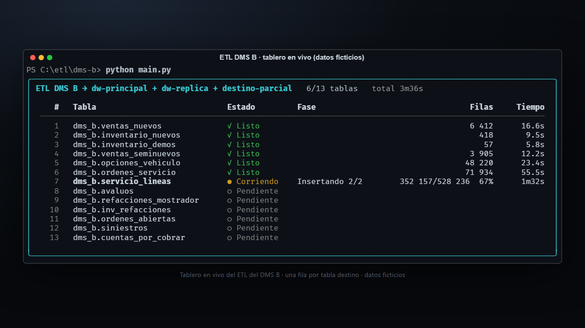
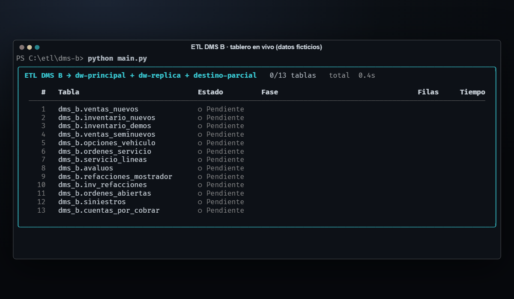
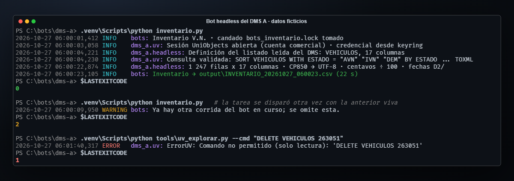
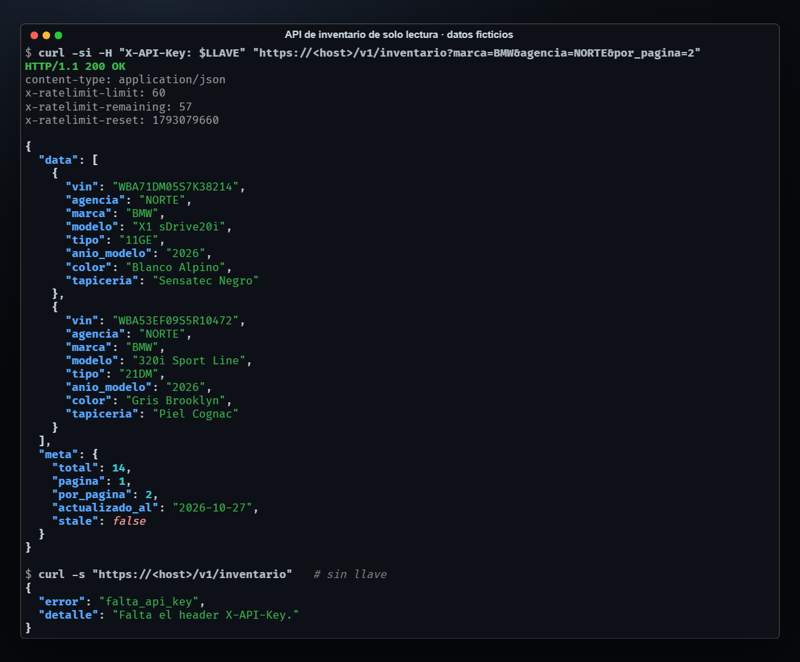
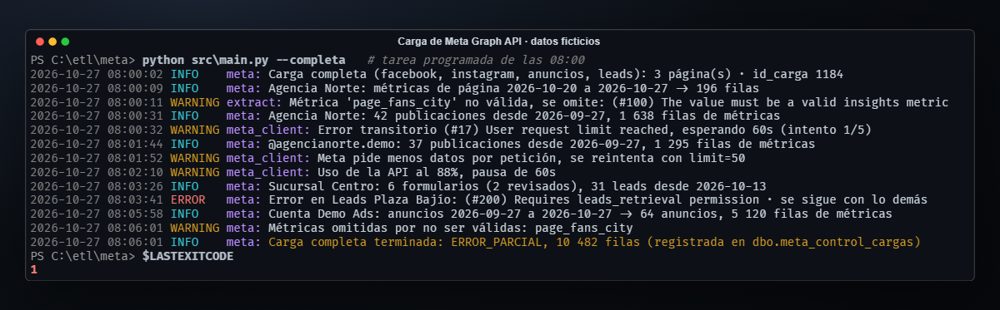
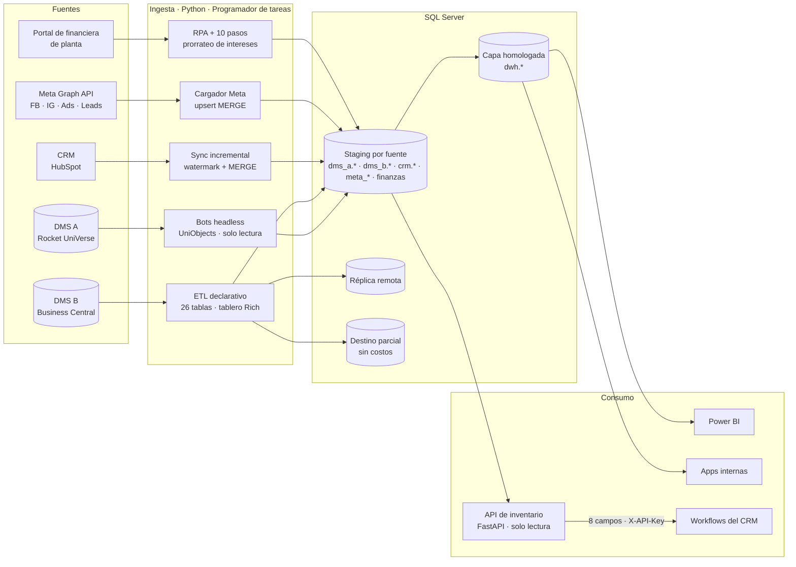

<div align="center">
  
  <h1>data-platform</h1>
  <p><b>La plataforma de datos de una red de concesionarios multimarca: dos DMS, un CRM, redes sociales y una financiera, en un solo DW homologado.</b></p>
  <p>
    <a href="#demo"></a>
  </p>
  <p>
    
    
    
    
    
    
    
    
  </p>
</div>

## El problema

El grupo opera marcas distintas sobre **dos DMS que no se parecen en nada**: uno comercial
montado sobre una base multivalor (Rocket UniVerse) y otro basado en Dynamics 365 Business
Central. Encima están el CRM, las campañas en Facebook e Instagram y los estados de cuenta de
la financiera de planta. Los reportes salían de robots de UiPath que manejaban la pantalla del
DMS (frágiles ante un cambio de resolución, atados a una sesión de escritorio abierta), de
exportaciones a Excel y de cruces a mano. Y "venta de nuevos" no significaba lo mismo en un DMS
que en el otro.

Este repo documenta cómo se convirtió eso en **una plataforma**: extractores de solo lectura por
fuente, un DW en SQL Server, una capa `dwh.*` que homologa los dos DMS, y consumidores (Power BI,
apps internas y una API para el CRM), todo con las mismas reglas de operación.

## Qué hace

- **Reemplaza robots de pantalla** por bots headless que consultan directo la base multivalor del DMS A, en solo lectura.
- **Carga 26 tablas del DMS B** desde un registro declarativo, a varios destinos a la vez, con un tablero en vivo en la terminal.
- **Homologa los dos DMS** en una capa `dwh.*` (7 vistas) a partir de planes escritos antes de construir.
- **Expone el inventario de nuevos al CRM** con una API REST de solo lectura que publica 8 campos y nunca lee los costos.
- **Baja métricas de Facebook, Instagram, anuncios y leads** desde Meta Graph API con manejo de límites de uso.
- **Sincroniza los deals del CRM** de forma incremental y reconcilia los servidores espejo.
- **Corre desatendida** desde el Programador de tareas de Windows, con candados, códigos de salida y logs con rotación.

## Demo



> Reproducción del tablero real (`ui.py`) con un cargador ficticio: mismas fases, mismo render,
> tablas y filas inventadas. Al final un destino se cae en una tabla; las demás tablas y destinos
> se cargan igual y el proceso sale con código 1.

| Bot headless del DMS A | API de inventario para el CRM | Carga de Meta Graph API |
|:---:|:---:|:---:|
|  |  |  |
| Corrida normal (0), corrida duplicada (2) y un comando de escritura rechazado por el candado de solo lectura (1) | 8 campos, cabeceras de rate limit y la misma forma de error para todo | Límite de uso, métrica inválida y una fuente con permiso faltante: la carga sigue y queda como `ERROR_PARCIAL` |

## Arquitectura



Cada pipeline escribe en su propio esquema de staging y nunca en el de otro. La capa `dwh.*` son
vistas `CREATE OR ALTER` encima de esos esquemas: se pueden redesplegar sin recargar nada, y
cada fila dice de qué sistema viene (`ORIGEN_SISTEMA`). La API para el CRM lee una sola tabla
con un usuario SQL que solo tiene `SELECT` sobre ella.

---

## 1. Bots headless del DMS A

El DMS A es un cliente de escritorio "ligero": los datos **y la definición de cada reporte**
viven en una base Rocket UniVerse. Los robots de UiPath abrían el programa, navegaban menús,
ponían filtros, exportaban a Excel y lo subían a SQL. Necesitaban un escritorio activo, RDP
abierto y una resolución fija; cuando algo se movía, se caían.

Los bots de Python piden el dato a la base, sin pantalla:

```
bot.py  (Python 64 bits)
   │  JSON por stdin: comandos de consulta + credencial (nunca en la línea de comandos)
   ▼
puente PowerShell 32 bits ── COM: UniObjects (la interfaz oficial del fabricante de la base)
   │
   ▼
Rocket UniVerse ── una sesión por llamada, abierta unos segundos
   │
   ▼  XML (TOXML) → pandas → CSV / SQL Server
```

| Bot | Antes | Ahora |
|---|---|---|
| Sábana de ventas de nuevos | UiPath sobre la GUI + Excel | segundos, directo a SQL |
| Inventario de nuevos | UiPath sobre la GUI | ~25 s |
| Inventario de seminuevos | UiPath sobre la GUI | ~1 min |
| Órdenes de taller activas | no existía | ~1 min |
| Movimientos de vehículos (ventana de 7 días) | no existía | ~75 s |
| Históricos, mes por mes | no existía | ~45 s por mes de ventas · ~20 ms por orden cerrada |

**Decisiones**

- **Pedir el dato, no la pantalla.** El reporte del DMS es una definición guardada en la base
  (archivo, columnas, encabezados, orden y filtros). El bot la lee **en cada corrida** y arma el
  `SORT … TOXML` equivalente. Si alguien modifica el reporte en el DMS, el bot lo sigue sin tocar
  código. Primero se hizo el mapa (campos ocultos del menú, pantalla de edición) y luego la
  búsqueda: lo que una búsqueda a ciegas no encontró en 30 minutos salió en uno.
- **Solo lectura por construcción, no por disciplina.** El puente valida el verbo de cada comando
  contra una lista blanca (`LIST`, `SORT`, `COUNT`, `CT`, `LIST.INDEX`…) y rechaza cualquier otro
  antes de abrir la sesión. Un archivo con documentos personales de empleados quedó excluido de
  toda consulta.
- **Si un botón escribe, no se pulsa: se reconstruye.** El reporte de seminuevos dependía de un
  botón que *graba* una foto del stock en la base. El bot no lo pulsa: rehace la foto desde los
  archivos maestros (unidades + movimiento vigente + las fórmulas del diccionario evaluadas con
  `EVAL`). Validado contra la foto que el DMS generó el mismo día: **99.9 % de celdas idénticas**,
  y cada diferencia restante está explicada.
- **Idéntico al Excel, celda por celda, con reglas y no con parches.** Texto en CP850, importes
  guardados en centavos, fechas en formato de EE.UU., recortes de columna del propio reporte:
  cada diferencia se resolvió con una regla general leída del diccionario de datos. Un comparador
  revisa el export del GUI contra el headless **con el texto exacto que llegaría a SQL**.
- **Rendimiento medido, no supuesto.** La carga de movimientos generaba un elemento XML por campo y
  por valor. Uniendo todas las columnas en **una sola expresión `EVAL`**, un día pasó de 16 s a 6 s
  y un mes de 410 s a 150 s, con resultado idéntico al método anterior.
- **Históricos que se pueden cortar y retomar.** Mes por mes: extrae, sube a `stg`, y un
  procedimiento valida conteo, rango de fechas, claves repetidas y conversiones; solo entonces
  **reemplaza ese mes en una transacción** y lo anota en `ctl.lotes`. Volver a correr retoma donde
  quedó. Una tabla por año con `CHECK` de fechas, unidas en una vista.

```python
SOLO_LECTURA = {"LIST", "SORT", "COUNT", "CT", "LISTF", "LIST.ITEM",
                "SORT.ITEM", "LIST.DICT", "LIST.INDEX", "SUM", "STAT"}

def validar(comando: str) -> str:
    verbo = comando.strip().split()[0].upper()
    if verbo not in SOLO_LECTURA:
        raise ErrorUV(f"Comando no permitido (solo lectura): {comando!r}")
    return comando
```

## 2. ETL del DMS B

Extrae de un DMS basado en Dynamics 365 Business Central (SQL Server vía ODBC) y carga a varios
destinos: el DW principal, una réplica remota y un destino parcial que solo recibe algunas tablas
con columnas descriptivas.

```python
# tablas/inventario_nuevos.py — una tabla = un archivo
TABLA = dict(
    nombre="inventario_nuevos",
    ddl=DDL,          # CREATE TABLE idempotente + ALTER aditivos (IF COL_LENGTH ... IS NULL)
    query=QUERY,      # SELECT con CTEs contra Business Central
    insert=INSERT,
    mapper=mapper,    # fila → tupla tipada
    variantes={"parcial": dict(ddl=DDL_PARCIAL, insert=INSERT_PARCIAL, mapper=mapper_parcial)},
)
```

**Decisiones**

- **Registro declarativo.** Cada tabla es un módulo con su DDL, su consulta, su `INSERT` y su
  mapper. `main.py` y `db.py` no saben nada de negocio: agregar la tabla 27 es agregar un archivo.
  `--solo <tabla>` recarga una sin tocar las demás.
- **Una consulta, N destinos, y uno caído no bloquea a los otros.** La consulta a Business Central
  corre **una vez**; las filas se insertan en cada destino dentro de su propio `try`. Si un destino
  falla se hace `rollback` ahí, se sigue con los demás y el error se levanta al final para que
  quede marcado en el tablero y en el código de salida. Si se cae el enlace a la fuente, se
  reconecta antes de la siguiente tabla; si no se puede, las restantes se marcan y se para.
- **Los costos no salen de donde no deben.** Un destino puede pedir una *variante* del esquema:
  mismas filas, menos columnas. El destino parcial recibe el inventario sin costos ni antigüedad.
  Se mapea una vez por variante, no una vez por destino.
- **Tablero en vivo sin acoplar el ETL a la terminal.** `cargar_tabla` reporta su avance por *duck
  typing* (`start / set_phase / set_total / advance / finish`). Sin tablero usa un `NullReporter` y
  corre igual: `--sin-ui` es el modo de la tarea programada. Un hilo refresca el cronómetro cada
  0.2 s para que la consulta larga, que no reporta avance, se vea viva. La inserción va en lotes
  de 2,000 con `fast_executemany` para mostrar porcentaje sin perder velocidad.

```python
for etiqueta, conn, variante in destinos:
    try:
        cargar_en(conn, esquemas[variante], filas[variante])
    except Exception as e:      # un destino caído no impide cargar los demás
        conn.rollback()
        errores.append(f"{etiqueta}: {type(e).__name__}")
if errores:
    raise DestinoError("; ".join(errores))   # tablero en rojo + exit 1
```

## 3. Capa homologada `dwh.*`

Dos DMS, dos modelos de datos, dos maneras de contar lo mismo. Antes de escribir una vista hay un
**plan de homologación** por dominio: qué hay de cada lado, el grano, el mapeo columna a columna,
las trampas encontradas, la validación y lo que queda pendiente.

| Dominio | Diferencia de grano | Decisión |
|---|---|---|
| Venta de refacciones | Línea de documento vs. agregado por documento y artículo | Bajar el grano del lado B a renglón, **en una tabla nueva** en vez de cambiarle el grano a la existente |
| Inventario de refacciones | Igual en los dos: (almacén, artículo) | Mapeo directo; la antigüedad se convierte con una regla verificada |
| Venta de autos nuevos | **1 fila por factura** (A) vs. **1 fila por VIN** (B) | Se respeta el grano de cada origen y se documenta; no se fuerza un desplegado que la fuente no guarda |
| Órdenes de servicio y activas | Tiempo en fracciones de hora con divisor distinto | El divisor lo dice el sistema origen, no una constante |
| Cuentas por cobrar | Asiento contable abierto | Cuadre contra el reporte de antigüedad de contabilidad |

**Decisiones**

- **`NULL` no es cero.** Cuando un dato no existe de un lado (los apoyos de marca por unidad, por
  ejemplo) la columna queda en `NULL`, para que las agregaciones **excluyan** esas unidades en vez
  de subestimarlas. Sumar columnas nulables sin `ISNULL` descarta la fila entera: el primer cálculo
  de apoyos dio una fracción del valor real por eso, y quedó documentado como trampa.
- **El margen de un auto nuevo vive en los apoyos.** Mapeando solo precio y costo, una marca
  aparecía perdiendo dinero. El plan lo detectó antes de construir el tablero, y la vista trae el
  bloque de apoyos con su origen explícito.
- **Los impuestos se mapean por cómo componen, no por cómo se llaman.** En un DMS el impuesto
  especial ya viene dentro del subtotal; en el otro va aparte. El mapeo correcto es
  `precio + impuesto ↔ subtotal`, verificado contra el total con IVA en prácticamente todas las filas.
- **Los errores de captura se aíslan y se documentan, no se maquillan en el ETL.** Una factura
  capturada con un factor de 1000× en el origen se excluye en la vista con un comentario que
  explica por qué y queda como pendiente de corregir en la fuente.

## 4. API de inventario para el CRM

API REST de solo lectura (FastAPI) para que el CRM vea las unidades nuevas en piso sin tocar el DW.

| Método | Ruta | Qué hace |
|---|---|---|
| GET | `/v1/inventario` | Listado con filtros, orden y paginación (máx. 200 por página) |
| GET | `/v1/inventario/{vin}` | Detalle de una unidad; 404 si ya no está en piso |
| GET | `/v1/inventario/resumen` | Conteos por marca, agencia y modelo |
| GET | `/v1/catalogos` | Valores distintos para poblar filtros |
| GET | `/health` | Estado y frescura del snapshot |

**Decisiones**

- **Lo que no se selecciona no se puede filtrar hacia afuera.** El contrato son 8 campos y el
  `SELECT` del repositorio trae solo esos. Costos, placas, lote y antigüedad ni siquiera se leen.
  Además, el usuario SQL de la API es propio y solo tiene `GRANT SELECT` sobre esa tabla.
- **Sin SQL construido con entrada del usuario.** El inventario es un snapshot chico que se
  refresca una vez al día, así que la API lo trae completo cada 5 minutos y filtra en memoria:
  respuestas de ~1 ms y cero superficie de inyección.
- **Un dato de hace unas horas es mejor que un 503.** Si el DW no responde, se sirve la última
  copia con `meta.stale = true` y se reintenta cada 30 s. Solo hay 503 si nunca hubo copia.
- **Rate limit en dos capas.** 120/min por IP en middleware, **antes** de validar la llave, para
  frenar a quien prueba llaves a ciegas; 60/min por llave en cada ruta. Corre con un solo worker
  a propósito: el contador vive en el proceso y con varios workers el límite real se multiplicaría.
  Varias llaves válidas a la vez permiten rotarlas sin cortar el servicio.
- **29 pruebas sin base de datos.** Un repositorio falso sustituye al real: autenticación, que
  salgan exactamente los 8 campos, filtros, paginación, degradación a `stale`, el 503 y el rate limit.

## 5. Meta Graph API → SQL Server

Páginas de Facebook, cuentas de Instagram, anuncios y formularios de leads, a tablas `meta_*`.

| Modo | Cuándo | Qué carga |
|---|---|---|
| `--completa` | Tarea diaria, 08:00 | Páginas, seguidores, métricas de la última semana, publicaciones de 30 días, anuncios y leads |
| `--posts-recientes` | Tarea diaria, 15:00 | Solo métricas de publicaciones de los últimos 3 días |
| `--historico --desde --hasta` | A mano | Rango completo, en ventanas |
| `--probar` | Antes de cambiar token o versión | Revisa token, páginas y cada métrica **sin escribir** en la BD |

**Decisiones**

- **Cada error de la API tiene su tratamiento.** Los códigos de límite de uso (4, 17, 32, 613,
  80001) esperan 60 s × intento; los transitorios y 5xx, *backoff* exponencial; "reduce the
  amount of data" parte el `limit` a la mitad, porque repetir la misma petición no sirve; todo lo
  demás falla de inmediato. Si las cabeceras de uso pasan del 85 %, se pausa **antes** de chocar.
- **Una métrica inválida no tumba la carga.** Meta retira métricas entre versiones. Se piden en
  bloque; si el bloque falla por métrica inválida, se reintenta una por una, se omite la que no
  existe y al final se reporta la lista.
- **Una página o fuente que falla no detiene a las demás.** La corrida se registra en una tabla de
  control con estado `OK`, `ERROR_PARCIAL` o `ERROR`, el detalle de cada falla y el número de filas.
- **Recargar es seguro.** Todo entra por tabla temporal + `MERGE` con claves deduplicadas antes,
  así que repetir una ventana actualiza en lugar de duplicar.

## 6. Pipelines satélite

| Pipeline | Qué hace | Lo que vale la pena ver |
|---|---|---|
| **Sync del CRM** (HubSpot) | Deals incrementales por fecha de última modificación, más dueños y etapas | Cada servidor guarda su propia marca de control y la descarga parte de la **más atrasada**: un espejo que falló una noche se pone al día solo. Un incremental nunca desactiva deals "que no vinieron". Un script de reconciliación compara espejo contra primario, copia lo que falta o está viejo y **reporta sin borrar** lo que sobra (`--revisar` no escribe). |
| **Intereses de piso** (portal de financiera de planta) | Desatendido cada mañana: descarga del portal con Selenium, 10 pasos en cascada y carga a SQL (~13 min) | El orquestador distingue pasos **críticos** de pasos que pueden fallar (la descarga tiene un plan B). El interés del mes se prorratea por días de custodia de cada unidad entre agencias y el residuo de centavos se asigna a la fila con mayor fracción decimal, así que **cada grupo cuadra al centavo** con el estado de cuenta. Pipeline heredado: lo documenté y lo opero. |

```python
# Cuadre al centavo por grupo: el redondeo no puede inventar ni perder dinero
for grupo, total_original in totales_por_grupo.items():
    idx = filas_del_grupo(grupo)
    residuo = round(total_original - round(asignado[idx].sum(), 2), 2)
    if abs(residuo) >= 0.01:
        mejor = fila_con_mayor_fraccion(idx)
        asignado[mejor] = round(asignado[mejor] + residuo, 2)
```

---

## Cultura de trabajo en los pipelines

Cada pipeline resuelve una fuente distinta, pero todos siguen las mismas reglas. Son las que
permiten dejarlos corriendo de noche sin nadie enfrente.

| Convención | Cómo se ve | Dónde |
|---|---|---|
| **Solo lectura hacia las fuentes** | Lista blanca de verbos en el puente a UniVerse; consultas `SELECT` contra Business Central; nunca se pulsa un botón que escribe en el DMS; la API usa un usuario con `SELECT` sobre una tabla | Bots, ETL, API |
| **Cargas idempotentes** | Correr dos veces deja lo mismo: DDL `IF … IS NULL` + `TRUNCATE`/`INSERT`; staging + validación + reemplazo de la ventana en una transacción; `MERGE` por clave | Todos |
| **Una corrida a la vez** | Candado por archivo y por bot (el sistema operativo lo libera si el proceso muere); tareas con "No iniciar una nueva instancia" | Bots, tareas programadas |
| **Códigos de salida que significan algo** | `0` OK · `1` falló (incluida una carga parcial) · `2` ya había otra corrida. El Programador de tareas marca la falla sin leer logs | Bots, ETL, Meta |
| **Las fallas no se encadenan** | Un destino, una página de Meta, una fuente o un espejo que falla no detiene a los demás; el error se reporta al final. Pasos críticos vs. no críticos en los orquestadores | ETL, Meta, CRM, financiera |
| **Logs con rotación** | Rotación diaria con 30 días de historia; `-v` incluye los comandos exactos enviados a la fuente; el log del ETL va a archivo para no pelear con el tablero | Bots, Meta, ETL |
| **Headless primero** | Nada necesita escritorio: las tareas corren "tanto si el usuario inició sesión como si no". El tablero es opcional (`--sin-ui`); las tareas se registran con un script (`programar_tareas.ps1`) en vez de a mano | Bots, ETL, Meta |
| **Modo de ensayo** | Cada pipeline tiene una forma de correr sin escribir: `--en-seco`, `--sin-cargar`, `--probar`, `--revisar`, `--solo <tabla>` | Bots, ETL, Meta, CRM |
| **Credenciales fuera del código** | Administrador de credenciales de Windows (`keyring`) o `.env` no versionado; la contraseña viaja al puente por stdin, nunca en la línea de comandos | Bots, API, Meta |
| **Homologar por escrito antes de construir** | Un plan por dominio con grano, mapeo, trampas y validación; las vistas citan la sección del plan que justifica cada regla | Capa `dwh.*` |
| **Validar contra un resultado conocido** | Conteos directos en la fuente, comparación celda por celda contra el export del GUI, cuadres contra los reportes de contabilidad | Bots, `dwh.*`, financiera |

## Stack

| Capa | Tecnología |
|---|---|
| Fuentes | Rocket UniVerse (UniObjects COM vía PowerShell de 32 bits), Dynamics 365 Business Central (ODBC), HubSpot API, Meta Graph API, portal web (Selenium), MySQL |
| Extracción y transformación | Python 3.11+, pandas, `pyodbc` con `fast_executemany`, `requests` |
| Almacenamiento | SQL Server: staging por fuente, esquemas `stg`/`ctl` para cargas por lote, capa `dwh.*` de vistas |
| Exposición | FastAPI + `slowapi`, Pydantic, uvicorn (un worker) pensado para ir detrás de un proxy TLS |
| Operación | Programador de tareas de Windows, candados por archivo, `TimedRotatingFileHandler`, `keyring` |
| Terminal | Rich: tablero en vivo, barras de progreso, reportes de reconciliación |
| Pruebas | `pytest` (API: 29 pruebas con repositorio falso) |
| Consumo | Power BI, apps internas, CRM |

## Sobre este repo

El código de negocio es privado. Aquí están la arquitectura, las decisiones y fragmentos
ilustrativos simplificados. Las imágenes son reproducciones con datos ficticios: el tablero
replica el `ui.py` real con un cargador falso, y las capturas de terminal usan nombres de
agencia, VIN y cifras inventados.

---
<sub>🔒 Pipelines reales en producción dentro de una red de concesionarios multimarca. El código
es privado; este repo contiene la documentación de la plataforma y visuales con datos ficticios.</sub>
